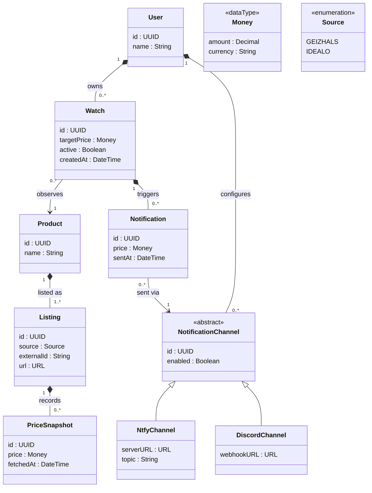

# Domain Model

This document describes the domain model of **DealStalker**, a self-hosted tool that tracks product prices on comparison sites and notifies users when their target price is reached.

The diagram is a UML class diagram on the conceptual level. It shows the concepts of the domain, their attributes and how they relate to each other. Technical concerns such as foreign keys, repositories, scrapers or HTTP clients are intentionally left out and belong to the design and persistence layers.

## Class diagram

## Entities

| Class | Meaning |
|---|---|
| `User` | A person using a DealStalker instance. Owns their watches and notification channels. |
| `Watch` | A user's intent to observe a product at a personal target price. Connects `User` and `Product`. |
| `Product` | The physical product being tracked (e.g. a specific SSD). Shared by all users who watch it. |
| `Listing` | `source` + `externalId` | The ID the source uses for the product (on Geizhals the `a<ID>` from the URL). URLs vary (query parameters, slug text), so the URL alone is not a reliable key. Adding a product that already exists reuses the existing listing and product, so each product is fetched only once per interval. |
| `PriceSnapshot` | One price observed for a listing at a specific point in time. Together they form the price history. |
| `NotificationChannel` | Abstract base for a way of reaching a user. Never instantiated directly. |
| `NtfyChannel` | Delivers notifications through an ntfy server and topic. |
| `DiscordChannel` | Delivers notifications through a Discord webhook. |
| `Notification` | Record of an alert that was sent for a watch through a channel at a given price. |

## Value types

| Type | Stereotype | Meaning |
|---|---|---|
| `Money` | `<<dataType>>` | An amount with a currency. Has no identity: two `Money` values with the same amount and currency are interchangeable. Amounts are stored as decimals, never as floating-point numbers. |
| `Source` | `<<enumeration>>` | The supported comparison sites. Geizhals is the MVP source, Idealo is planned. |

## Identity and uniqueness

Every entity has a technical identifier `id` of type UUIDv7. IDs are generated in the application, not by the database, using `uuid.NewV7()` from [`github.com/google/uuid`](https://github.com/google/uuid). `NtfyChannel` and `DiscordChannel` inherit their `id` from `NotificationChannel`. Value types have no `id`.

In addition to the technical ID, some entities have a natural key that must be unique. These rules are enforced as unique constraints in persistence:

| Entity | Unique by | Reason |
|---|---|---|
| `Listing` | `source` + `url` | Adding a URL that already exists reuses the existing listing and product, so each product is fetched only once per interval. |
| `Watch` | `User` + `Product` | A user cannot watch the same product twice. |

The associations in the diagram become foreign keys in the persistence model (e.g. `Watch` references `User` and `Product`). They are not shown as attributes here.

## Design decisions

**`Watch` separates users from products.** The target price belongs to the relationship between a user and a product, not to either of them. This keeps `Product` free of user-specific data, so a product watched by several users is stored and fetched only once.

**`Product` and `Listing` are separate.** A product is the thing being tracked, a listing is where it is found. New sources can be added by creating additional listings without changing the model.

**Price history is kept.** Every fetch creates a `PriceSnapshot` instead of overwriting the current price, which allows the frontend to show price trends.

**Sent notifications are recorded.** `Notification` makes it possible to avoid alerting a user again on every fetch while the price stays below the target.

**UUIDv7 as identifier.** UUIDv7 values can be created in code before anything is persisted, which keeps domain logic independent of the database and simplifies testing. Unlike UUIDv4 they are ordered by creation time, which keeps database indexes efficient. IDs are not guessable, but this is not a security measure on its own: every request must still verify that the requested resource belongs to the requesting user.

## Out of scope

The following are deliberately not part of the domain model: the fetch interval (system configuration), scraping and HTTP logic, persistence and repositories, and authentication.

## Notation

| Symbol | Meaning |
|---|---|
| Filled diamond (`*--`) | Composition: the part cannot exist without the whole and is deleted with it. |
| Arrow (`-->`) | Directed association: the source knows the target, not the other way round. |
| Hollow triangle (`<\|--`) | Generalization: the subclass is a specialization of the superclass. |
| `1`, `0..*`, `1..*` | Multiplicities: exactly one, any number, at least one. |
| `<<abstract>>`, `<<dataType>>`, `<<enumeration>>` | UML stereotypes. |
